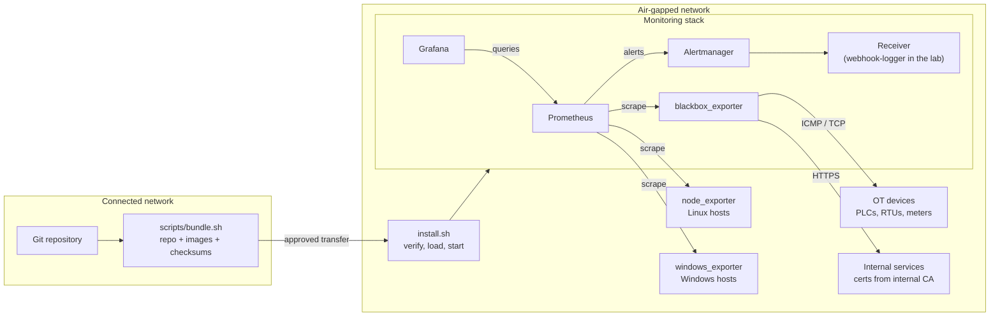

# Architecture

## Overview

## Components

| Component         | Role                                                                     | Exposed                |
| ----------------- | ------------------------------------------------------------------------ | ---------------------- |
| Prometheus        | Scrapes metrics, evaluates recording and alert rules, stores time series | 127.0.0.1:9090         |
| Alertmanager      | Routes, groups and inhibits alerts, sends notifications                  | 127.0.0.1:9093         |
| Grafana           | Dashboards, provisioned from files                                       | 127.0.0.1:3000         |
| node_exporter     | Linux host metrics                                                       | internal only          |
| windows_exporter  | Windows host metrics, installed on each Windows host                     | port 9182 on that host |
| blackbox_exporter | Probes from outside: HTTP, ICMP, TCP, TLS                                | internal only          |
| webhook-logger    | Lab stand-in for a notification receiver                                 | internal only          |
| tls-demo          | Lab HTTPS service signed by the lab CA                                   | internal only          |

## How data and alerts flow

1. **Collection.** Prometheus pulls metrics from exporters every 15 seconds. Targets come from
  files in `prometheus/targets/`, so hosts are added without touching the main config.
2. **Normalisation.** Recording rules turn Linux and Windows metrics into shared series
  (`instance:cpu_utilisation:ratio` and others) with an `os` label.
3. **Alerting.** Alert rules read those shared series, so one rule covers both operating systems.
  Each alert has a severity and a runbook link.
4. **Routing.** Alertmanager sends `critical` to on-call and `warning` to the team queue, groups
  related alerts, and inhibits symptoms when the root cause is already alerting.
5. **Liveness of alerting itself.** `Watchdog` always fires. If it stops arriving, alerting is broken.

## Design decisions

**Pull, not push.** Prometheus decides what to scrape and notices immediately when a target stops
answering (`up == 0`). Exporters stay simple and hold no state.

**Probes alongside exporters.** Many OT devices can't run an exporter. Ping and TCP port checks
are often the only monitoring possible, and they also catch cases where a host reports healthy
but its service doesn't answer.

**Everything as code.** Datasources, dashboards, rules, routing and targets are files in git.
The UI is read-only for provisioned content, so the repository is the source of truth.

**Tested like code.** Alert rules have unit tests, including negative cases. Routing has tests.
CI starts the full stack and checks the whole alert path end to end.

**Offline first.** Versions are pinned, nothing contacts the internet (Grafana update checks,
Gravatar, external snapshots and plugin downloads are all disabled), and the stack installs from
a verified bundle with pulls disabled.

**Least privilege.** Read-only root filesystems, no Linux capabilities except `NET_RAW` for ICMP,
non-root processes, ports bound to localhost, resource limits, and bounded logs and storage.

## Lab versus production

| Area               | In this lab                          | In production                                                                                 |
| ------------------ | ------------------------------------ | --------------------------------------------------------------------------------------------- |
| Notifications      | webhook-logger prints to the console | Internal SMTP relay, internal chat (Mattermost, Rocket.Chat) or SMS through a GSM modem       |
| Alertmanager       | Single instance                      | Two or three in a cluster, so alerting survives a server failure                              |
| Watchdog           | Visible in the logger                | Sent to an independent dead man's switch that alarms when it stops                            |
| Grafana access     | HTTP on localhost, local admin       | HTTPS with a certificate from the internal CA, `cookie_secure` on, central login (LDAP or AD) |
| CA private key     | On disk in `certs/private/`          | Offline or in an HSM                                                                          |
| Bundle integrity   | SHA256 checksums                     | Checksums signed with GPG or cosign, plus a vulnerability scan before transfer                |
| Image distribution | `docker load` on the host            | Internal registry (e.g. Harbor) inside the air-gapped network                                 |
| Targets            | Hand-written files                   | Generated from a CMDB or Ansible inventory, reviewed in git                                   |
| Retention          | 15 days, 5 GB                        | Sized for the site, possibly with long-term storage (Thanos, Mimir)                           |

